<p align="center">
  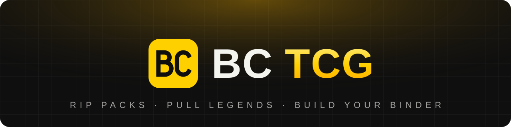
</p>

<p align="center">
  <b>A cinematic, scroll-driven Pokémon card pack site.</b><br>
  Scrub through a 53-second film with your scroll wheel, pick a rarity, and tear a pack open with your cursor.
</p>

<p align="center">
  
  
  
  
  
  
</p>

<p align="center">
  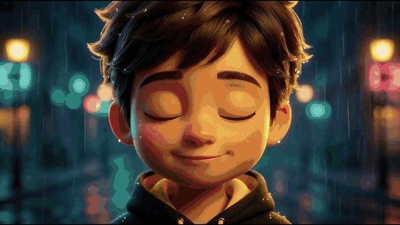
</p>

---

## Contents

- [About](#about)
- [The hero: a film you scroll](#the-hero-a-film-you-scroll)
- [Ripping a pack](#ripping-a-pack)
- [Feature highlights](#feature-highlights)
- [Tech stack](#tech-stack)
- [Getting started](#getting-started)
- [Project structure](#project-structure)
- [How the scroll film works](#how-the-scroll-film-works)
- [Tuning the hero](#tuning-the-hero)
- [Accessibility and performance](#accessibility-and-performance)
- [Roadmap](#roadmap)
- [Credits](#credits)

---

## About

**BC TCG** is a premium, black-and-yellow digital storefront for **BC Rip's**, an online trading-card pack shop. It presents the full "buy → rip → keep" customer journey as scroll storytelling, built to the standard of Apple product pages and Awwwards-winning sites.

The home page is one long pinned scene. Scrolling plays a custom-made film frame by frame, and every caption leads customers to a real part of the store. Below the film, five rarity tiers float in a 3D product showcase. On the **Packs** page, customers spin a ring of packs, choose one from a stack, and slice it open with a mouse or finger to pull a card.

> Everything runs on mock data. No real money, accounts or payments are involved.

---

## The hero: a film you scroll

The opening screen is a gold headline on black. As you scroll, its lines slide away, the black tears diagonally and the film appears behind it. From then on, **scroll position = frame number**: stop scrolling and the film freezes on that exact frame, scroll up and it plays backwards.

<p align="center">
  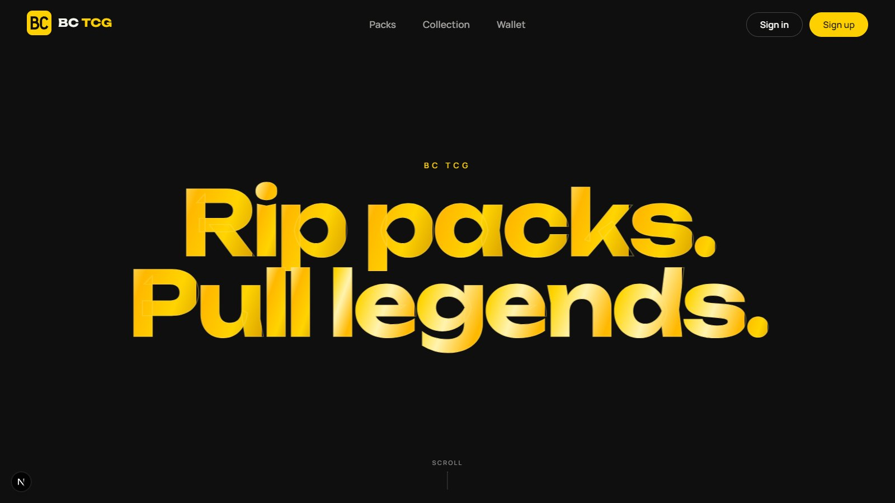
</p>

Each chapter of the film has a caption that names a feature of the site:

<table>
  <tr>
    <td width="50%">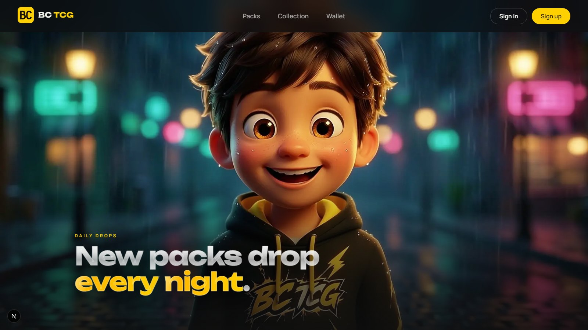</td>
    <td width="50%">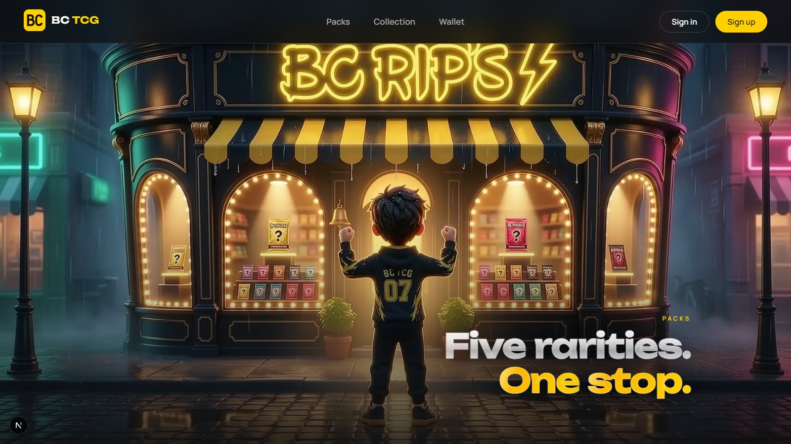</td>
  </tr>
  <tr>
    <td align="center"><sub><b>01 · Night</b> · Daily drops</sub></td>
    <td align="center"><sub><b>02 · The shop</b> · Packs</sub></td>
  </tr>
  <tr>
    <td>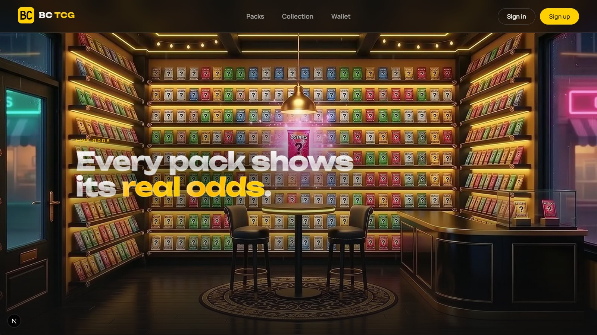</td>
    <td>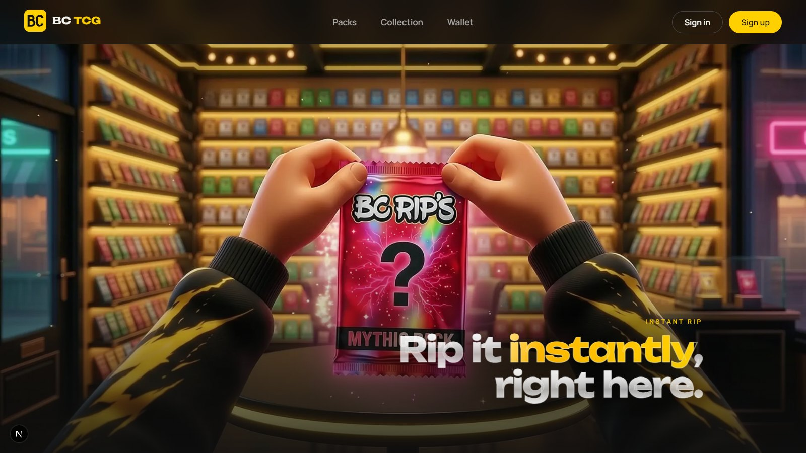</td>
  </tr>
  <tr>
    <td align="center"><sub><b>03 · The pick</b> · Live odds</sub></td>
    <td align="center"><sub><b>04 · The rip</b> · Instant rip</sub></td>
  </tr>
  <tr>
    <td>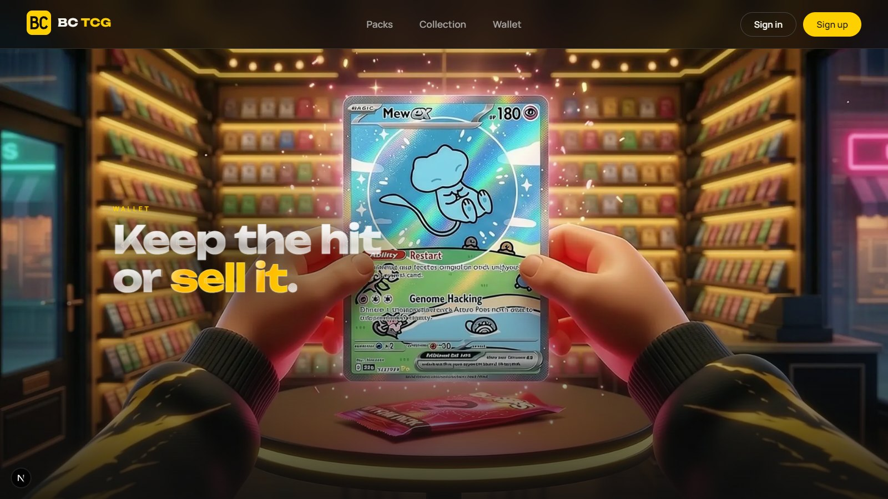</td>
    <td>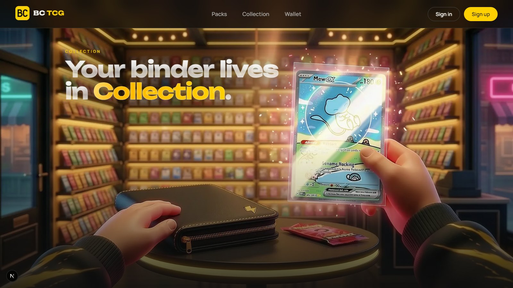</td>
  </tr>
  <tr>
    <td align="center"><sub><b>05 · The pull</b> · Wallet</sub></td>
    <td align="center"><sub><b>06 · The keep</b> · Collection</sub></td>
  </tr>
</table>

<p align="center">
  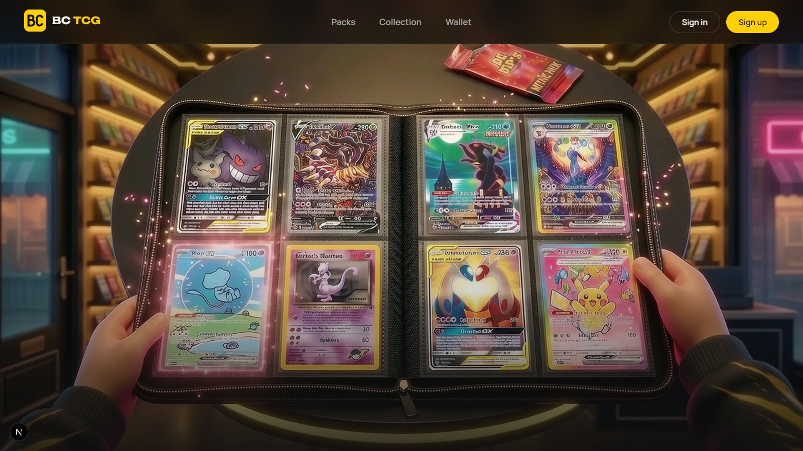<br>
  <sub>The film ends on a finished binder, with a <b>Rip your first pack</b> button that leads to the Packs page.</sub>
</p>

---

## Ripping a pack

Right below the film, a 3D pack showcase shows every rarity with its price and real pull odds.

<table>
  <tr>
    <td width="50%">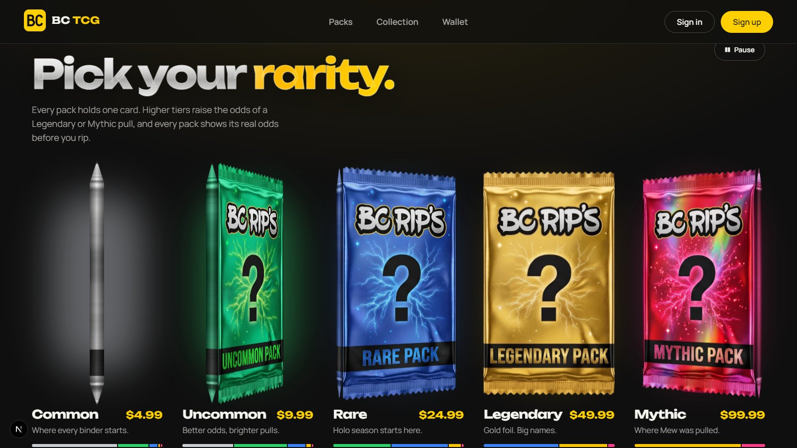</td>
    <td width="50%">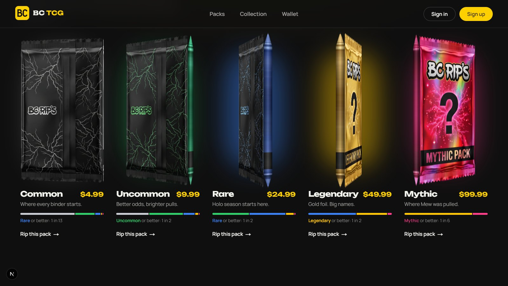</td>
  </tr>
</table>

The **Packs** page turns opening a pack into three steps:

<table>
  <tr>
    <td width="33%">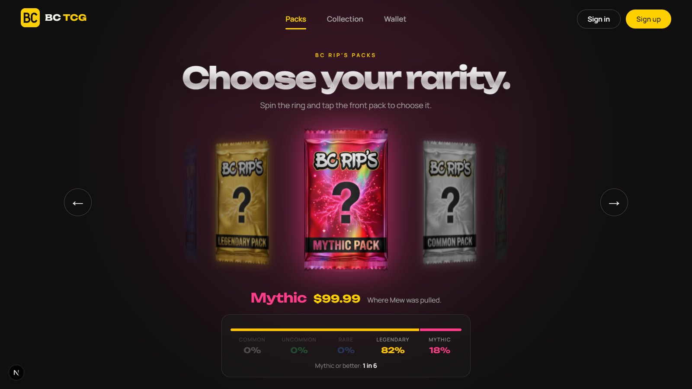</td>
    <td width="33%">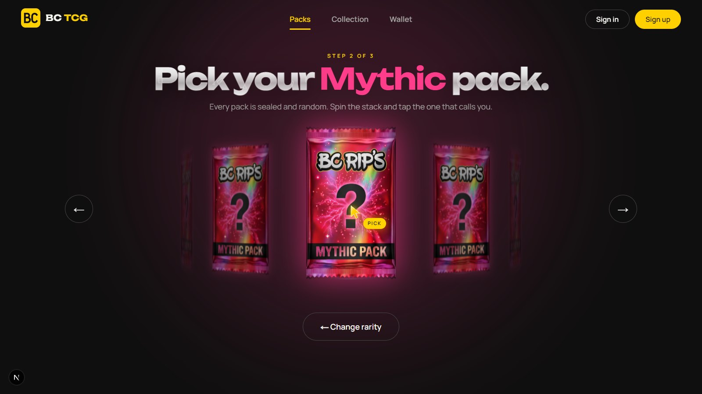</td>
    <td width="33%">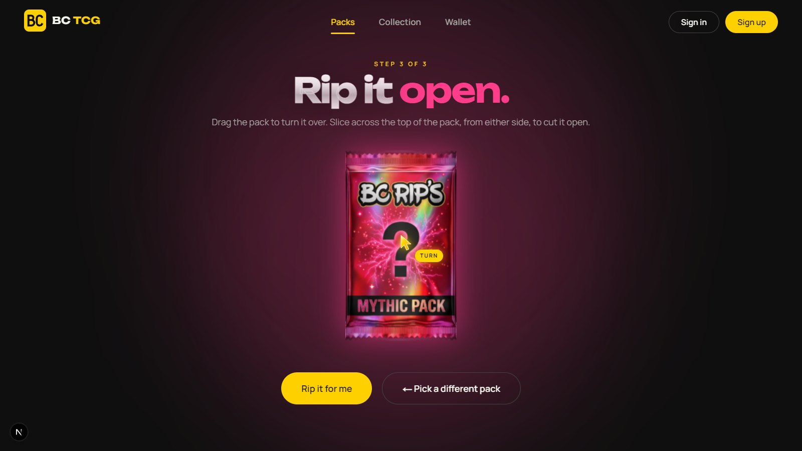</td>
  </tr>
  <tr>
    <td align="center"><sub><b>1 · Choose your rarity</b><br>Spin the ring of five packs. Odds update live.</sub></td>
    <td align="center"><sub><b>2 · Pick your pack</b><br>Every pack is sealed and random.</sub></td>
    <td align="center"><sub><b>3 · Rip it open</b><br>Drag to turn it over, slice across the top.</sub></td>
  </tr>
  <tr>
    <td>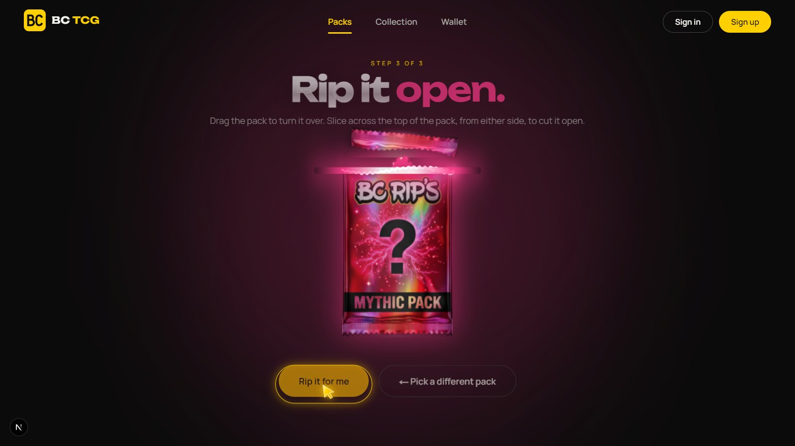</td>
    <td>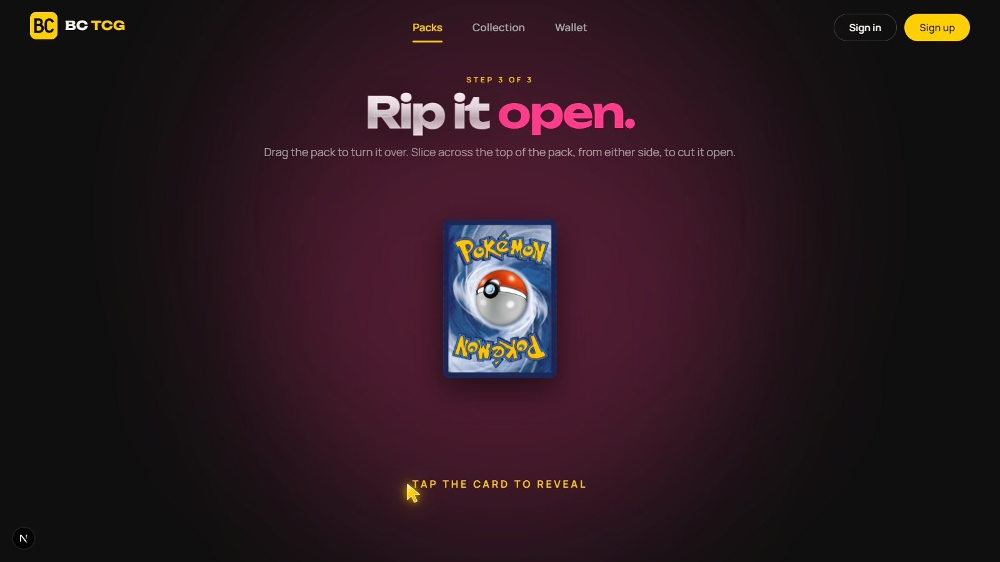</td>
    <td>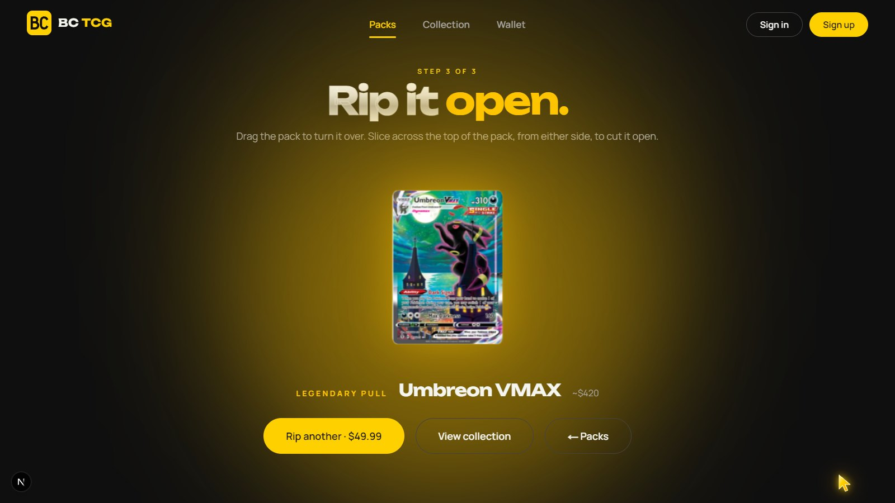</td>
  </tr>
  <tr>
    <td align="center"><sub><b>The tear</b><br>Cut from either side, front or back.</sub></td>
    <td align="center"><sub><b>Face down</b><br>The card slides out of the pack.</sub></td>
    <td align="center"><sub><b>The pull</b><br>Tap to reveal, with rarity and value.</sub></td>
  </tr>
</table>

<p align="center">
  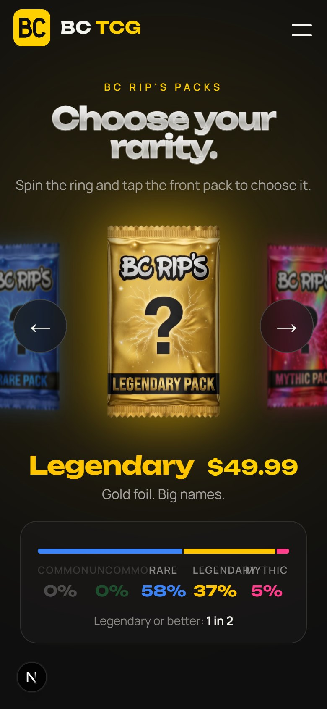<br>
  <sub>The whole flow works with touch on phones.</sub>
</p>

---

## Feature highlights

| | |
|---|---|
| 🎬 **Scroll-scrubbed film** | 1,604 hand-tuned frames drawn to a full-screen `<canvas>`, locked to scroll position and reversible. |
| 📱 **Phone-friendly hero** | Phones scrub an all-keyframe MP4 instead of loading image frames, so fast flicks stay smooth. |
| ✂️ **Tear-to-open packs** | Slice across the top band of a pack with the cursor or a finger. Short cuts heal; long ones tear through. |
| 🔄 **Two-sided 3D packs** | Packs have real fronts, backs and edges. Drag to turn them over in the ring, the stack and the rip. |
| 🎲 **Real odds** | Five tiers from Common ($4.99) to Mythic ($99.99), each with published odds that the pull roll uses. |
| ✨ **Gold cursor** | A glowing arrow cursor with magnetic buttons and contextual labels such as "Drag". |
| 🧈 **Smooth scrolling** | Lenis with a light lerp: smooth, but it stops almost the moment you do. |
| 🎛️ **One config file** | Every scene time, caption, frame path and intro timing lives in [`src/lib/hero-config.ts`](src/lib/hero-config.ts). |
| 🌗 **Three caption styles** | Solid, liquid glass or frosted panel. Preview any of them with `?text=solid`, `?text=liquid` or `?text=glass`. |
| ♿ **Reduced motion** | With `prefers-reduced-motion`, the film becomes still key frames with the same captions. |

---

## Tech stack

| Layer | Choice |
|---|---|
| Framework | [Next.js 15](https://nextjs.org) (App Router) + React 19 |
| Language | TypeScript 5 |
| Styling | Tailwind CSS 4 with design tokens in CSS variables |
| Animation | [Motion](https://motion.dev) (`motion/react`): springs, scroll progress, gestures |
| Scrolling | [Lenis](https://lenis.darkroom.engineering) |
| Fonts | Unbounded (display) + Manrope (body) via `next/font` |
| Tooling | ESLint, Sharp, Puppeteer and three.js for the frame render scripts |

**Design tokens:** night `#0F0F0F`, jet `#2A2929`, jonquil `#FFD000`, selective yellow `#FFB700`, off-white `#F5F5F0`.

---

## Getting started

You need **Node.js 20+** and **Git LFS** (the phone hero video is stored with LFS).

```bash
git lfs install
git clone https://github.com/SatyaNagu/BCG_TCG_Rips.git
cd BCG_TCG_Rips
npm install
npm run dev
```

Then open <http://localhost:3000>.

| Script | What it does |
|---|---|
| `npm run dev` | Starts the dev server on port 3000 |
| `npm run build:check` | Production build into `.next-check`, so it can run alongside the dev server |
| `npm run start:check` | Serves that build on port 3200 |
| `npm run build` / `npm start` | Standard production build and server |
| `npm run lint` | Runs ESLint |
| `npm run frames` | Generates placeholder hero frames |
| `npm run hero:textures` / `npm run hero:render` | Frame render pipeline in `scripts/hero-render` |

---

## Project structure

```text
src/
├─ app/                     Routes: / · /packs · /collection · /wallet · /signin · /signup
│  ├─ layout.tsx            Fonts, header, gold cursor, smooth scroll
│  └─ globals.css           Design tokens (colours, easing, durations)
├─ components/
│  ├─ hero/                 HeroSequence (canvas), VideoScrub (phones), CinematicOverlay, captions
│  ├─ home/                 PackShowcase: 3D floating packs with odds bars
│  ├─ packs/                PackStore → PackRing → PackOpener, Pack3D geometry
│  ├─ layout/               Header, MobileMenu, nav items
│  ├─ providers/            SmoothScroll (Lenis), GoldCursor
│  └─ ui/                   Button, HeroShutterText
└─ lib/
   ├─ hero-config.ts        Scene timings, captions, frame sets, intro settings
   └─ packs.ts              Packs, rarities, odds, card pool, pull roll
public/
├─ frames/desktop|mobile    1,604 WebP frames per set
├─ video/hero-mobile.mp4    All-keyframe video for phones (Git LFS)
├─ packs/  cards/           Pack fronts and backs, card art
scripts/                    Placeholder frames and hero render pipeline
assets/                     Source film (Git LFS) and redesign stills
docs/                       README banner and screenshots
```

---

## How the scroll film works

```text
 scroll position ──► progress 0…1 ──► frame index ──► draw on <canvas>
        ▲                                                │
        └────────── Lenis (light lerp) ◄─────────────────┘  only redraws when the frame changes
```

1. The hero is a sticky section **2,750 viewport heights** tall. Its scroll progress (0 → 1) maps to a frame index.
2. The first frame shows at once; the rest load progressively, and a small yellow loader stays up until 15% of them are ready.
3. Frames are drawn with `requestAnimationFrame`, only when the index changes, and scaled for `devicePixelRatio` with `object-fit: cover` maths.
4. Viewports narrower than an aspect ratio of 0.8 switch to the portrait set; phones scrub `hero-mobile.mp4`, encoded with every frame as a keyframe (`ffmpeg -g 1`) so seeking is instant.
5. Captions are tied to progress, not time, so they fade in and out in reverse just as cleanly as they do forwards.

---

## Tuning the hero

Everything lives in [`src/lib/hero-config.ts`](src/lib/hero-config.ts):

```ts
scenes: [
  { id: "night", start: 0,     end: 0.168, caption: "New packs drop|[every night].", kicker: "Daily drops", place: "bl" },
  { id: "shop",  start: 0.168, end: 0.337, caption: "Five rarities.|[One stop.]",    kicker: "Packs",       place: "br" },
  // …
],
```

- `|` splits a caption into two lines, and `[brackets]` make a word gold.
- `start` / `end` are fractions of the film (seconds ÷ 53.5).
- `place` sets the caption corner: `bl`, `br`, `tl`, `tr`, `ml` or `mr`.
- `look: "classic"` switches back to the earlier plain captions, and `textStyle` picks the caption style.

---

## Accessibility and performance

- Keyboard support throughout: the pack ring rotates with ← / →, and **Enter** chooses.
- Visible yellow focus rings and high-contrast black and yellow colours.
- `prefers-reduced-motion` swaps the film for key frames and turns off the cursor effects and decorative motion.
- Animations stick to `transform` and `opacity`, and the canvas only redraws when the frame changes.
- The header turns into a frosted bar once you scroll, and becomes a full-screen menu on mobile.

---

## Roadmap

- [x] Brand, design tokens and BC monogram logo
- [x] Fixed header with frosted scroll state and mobile menu
- [x] Scroll-scrubbed hero film with chapter captions
- [x] 3D pack showcase with odds
- [x] Packs page: ring → stack → tear-to-open → reveal
- [ ] Collection: filterable binder of pulled cards
- [ ] Wallet: balance, mock top-ups, history and listing cards for sale
- [ ] Sign in / sign up forms

---

## Credits

Designed and built by **[Satya Nagu](https://github.com/SatyaNagu)** for BC Rip's.

Pokémon and all related names and card art are trademarks of Nintendo, Creatures Inc. and GAME FREAK inc. BC TCG and BC Rip's are not affiliated with, endorsed by or sponsored by them.

<p align="center">
  
</p>
